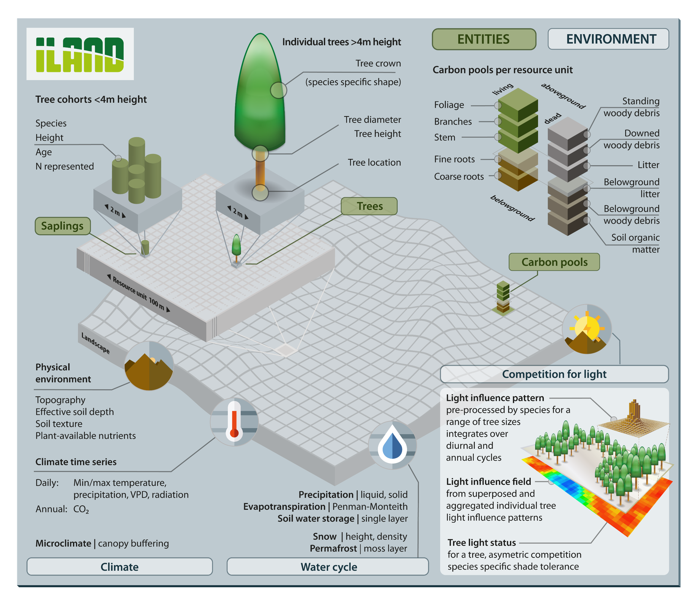
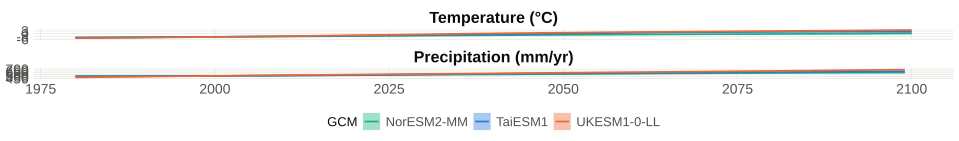
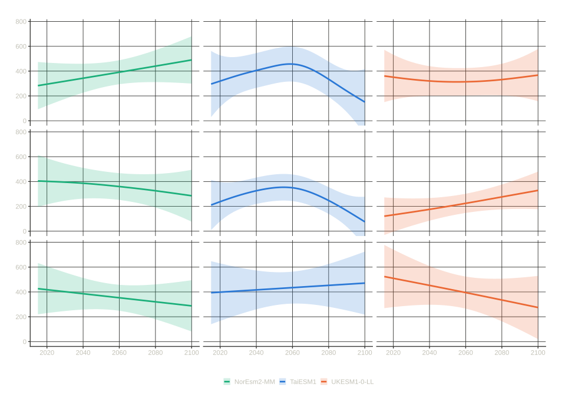
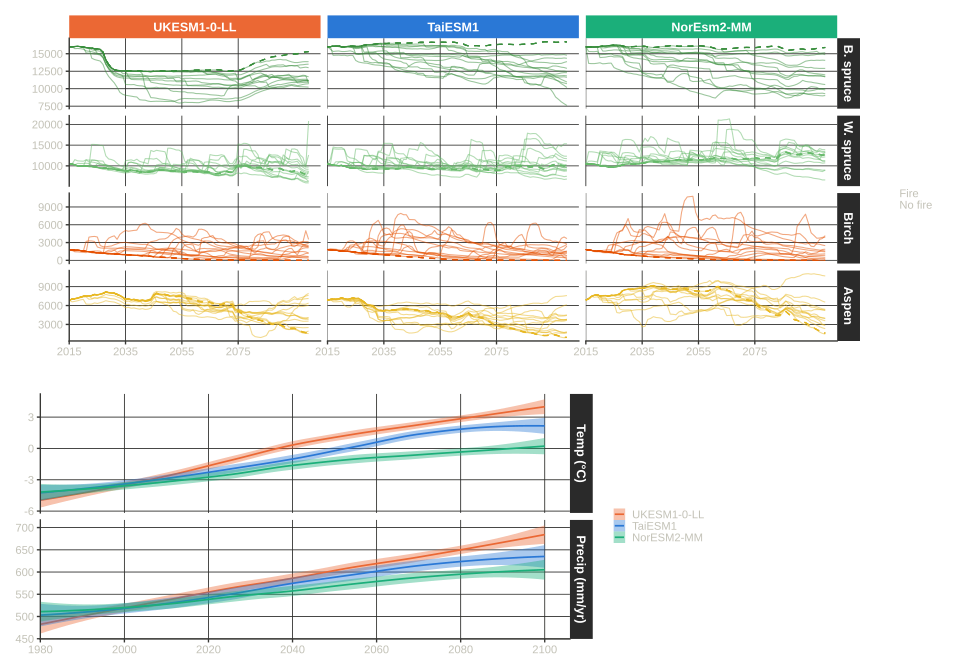
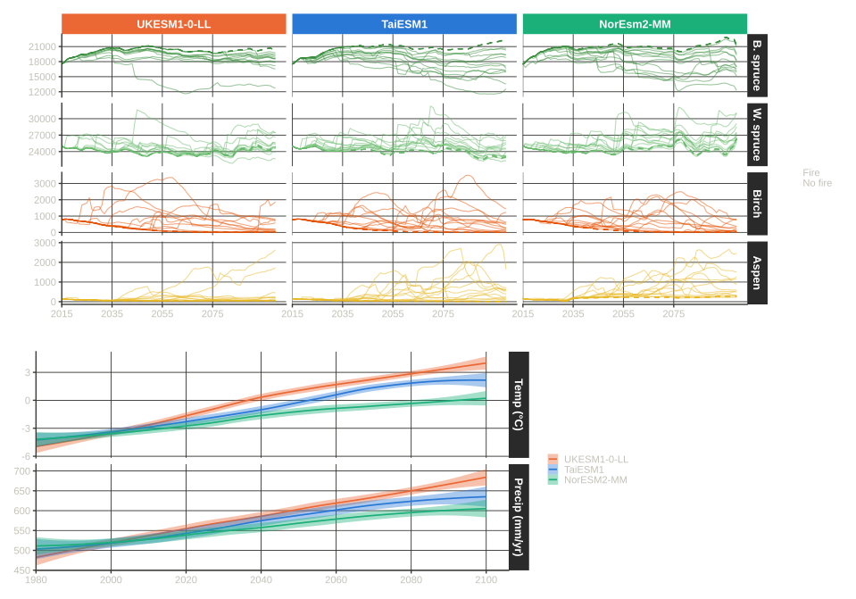
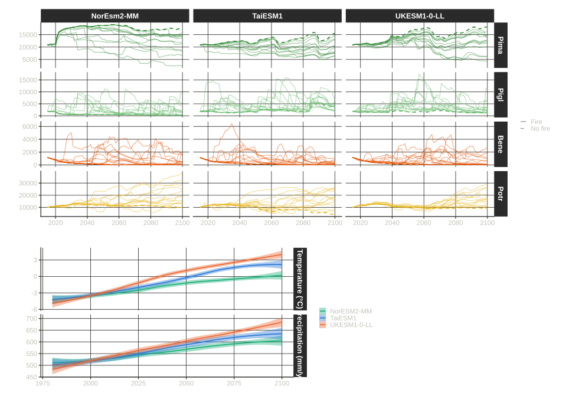

## Acknowledgements {.smaller}

:::: {.columns}
::: {.column width="60%"}

Many people contributed time and data:

- Jill Johnstone
- Xanthe Walker
- Jazlynn Hall
- Brendan Rogers
- Michelle Mack

:::
::: {.column width="40%"}

Thanks to funders:

- National Science Foundation

{fig-align="center" width="25%" .nostretch}

:::
::::

## iLand model: individual-based forest landscape and disturbance model {.smaller}

:::: {.columns}
::: {.column}

- Simulates:
  - individual trees at the species-level
  - fire on the landscape
  - permafrost

:::
::: {.column}

{fig-align="center"}

:::
::::

::: {.footer}
@seidl2012
:::

## Question {.smaller}

*What are the relative impacts of fire on vegetation vs vegetation on fire under future climates?*

 

**Expectations:**

- Fire affects forests by breaking legacy locks and allowing for reorganization
- Forests affect fire through fuel loads and connectivity
- The relative strength of each is important for understanding the nature of ecosystem change in the future with warming

## Study area {.smaller}

:::: {.columns}
::: {.column width="40%"}

- Using iLand we simulated 4 species across 3 landscapes in interior Alaska:
  - Conifers: black and white spruce
  - Deciduous: aspen and birch
- Each landscape is 60 kha in size

:::
::: {.column width="60%"}

{fig-align="center"}

:::
::::

## Study design {.smaller}

:::: {.columns}
::: {.column width="50%"}

**Scenario conditions:**

- Climate data from 3 CMIP6 Global Circulation Models (GCMs)
- 1 Shared Socioeconomic Pathway (SSP) - 2-4.5
  - intermediate / middle of the road scenario
- Simulated landscapes covering 2015-2100
  - two fire feedback conditions - on/off

:::
::: {.column width="50%"}

**We'll look at:**

- What climate doing
- What fire doing
- What vegetation doing
- How does everything interact

:::
::::

## What is climate doing? {.smaller}

::: {style="text-align: center;"}
*Showing 3 GCMs from CMIP6 for ssp2-4.5*
:::

:::: {.columns}
::: {.column width="50%"}

- NorESM, TaiESM, and UKESM chosen for spread in temperature and precipitation
  - UKESM warmest and wettest
  - NorESM coolest and driest
  - TaiESM in the middle

:::
::: {.column width="50%"}

{fig-align="center" alt="Climate projections for 3 GCMs under ssp2-4.5 for the study area in interior Alaska. The top panel shows temperature and the bottom panel shows precipitation."}

:::
::::

## What is fire doing? {.smaller}

{fig-align="center"}

## What is fire doing? {.smaller}

:::: {.columns}
::: {.column width="50%"}

- Initial expectation was:
  - *warmer conditions → more fire → shift towards a deciduous composition*
- Under these GCM-SSPs boreal region also getting wetter

::: {.incremental}
- Fire maybe not increasing as much as expected... :confused:
:::

:::
::: {.column width="50%"}

{fig-align="center"}

:::
::::

::: {.incremental}
- Caveat: we are examining model parameters of drought index, which might affect fire response to climate
:::

## What is vegetation doing? {.smaller}

- Initial expectation was an expansion of deciduous species with increased fire
-
- 

## Fire feedbacks on vegetation 1 {.smaller}

{fig-align="center"}

## Fire feedbacks on vegetation 2 {.smaller}

{fig-align="center"}

## Fire feedbacks on vegetation 3 {.smaller}

{fig-align="center"}

## Conclusion 1 {.smaller}

1. Fire breaks the legacy lock of existing species composition and allows deciduous vegetation to expand

2. In the absence of fire climate alone will not break the legacy lock

3. This result is consistent with fire feedback expectations

## Conclusion 2 {.smaller}

1. Climate is getting warmer but also a lot *wetter*

2. Climate is important for driving fire and shaping downstream feedbacks between vegetation and fire.

## Conclusion 3 {.smaller}

1. Previous work showed that long-term legacies are important
  - Transferring from CMIP5 to CMIP6 altered species trajectories due to climate-fire legacies

2. If fire histories are important then so are fire futures

3. Future fire is controlled by the interaction of climate-driven ignition pressure, fuel availability, and vegetation change

## Work in progress :construction_worker: {.smaller}

Our complete study design is a $3 \times 3 \times 3 \times 2 \times 3$ study design:

- 3 GCMs
- 3 SSPs
- 3 landscapes in Alaska plus 3 in Canada
- Fire feedbacks on/off
- Possibly 3 fire return intervals

Just a matter of core hours...

## Future directions {.smaller}

- Carbon dynamics in permafrosts
- Species establishment under future climate and fire
  - Surface organic layer depth is an important factor to establishment
  - How will the permafrost active layer respond to climate and future fire?
- How does the microbial community change with climate and fire?

## References

